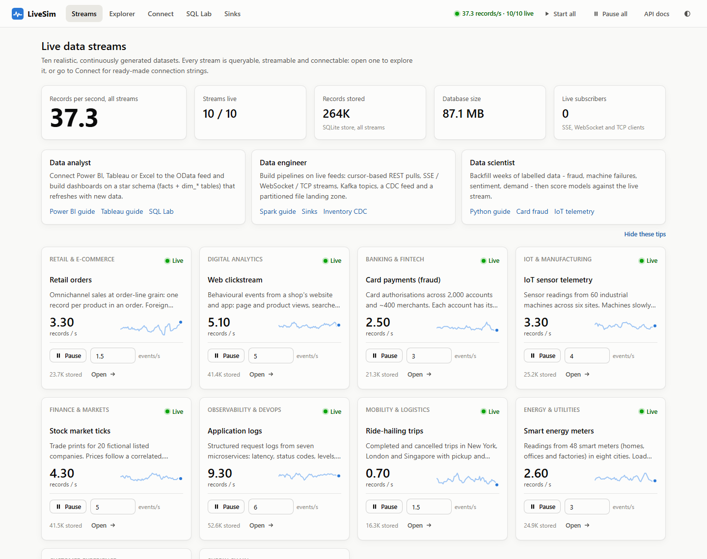

# LiveSim: live data for practising data work

LiveSim generates realistic data continuously across ten business domains and serves it through
the interfaces data teams actually use: Power BI, Tableau, Excel, SQL databases, Python, R,
Spark, Kafka, REST, OData, Server-Sent Events, WebSockets, files and webhooks.

Analysts, engineers and scientists can use it to practise or prototype against data that keeps
changing. It includes labelled data for machine learning, a change-data-capture (CDC) feed,
star-schema dimension tables, optional dirty data, and history you can backfill on demand.



## Quick start

| Platform | Command |
|---|---|
| **Windows** | Double-click `start.bat` (or run `.\start.ps1` in PowerShell) |
| **macOS / Linux** | `./start.sh` |
| **Docker** (with PostgreSQL) | `docker compose up --build` |
| **Docker + Kafka** | `docker compose -f docker-compose.yml -f docker-compose.kafka.yml up --build` |
| **Manual** | `pip install -r requirements.txt` then `python -m livesim` |

Then open **http://localhost:8000**. On first start, each stream gets two days of history
(about 30 seconds), so dashboards have trends straight away. All ten streams start running
automatically.

Requirements: Python 3.10+. The launch scripts create a `.venv` folder and install dependencies
on first run. Optional sinks need extra packages: `pip install -r requirements-optional.txt`
(SQLAlchemy and psycopg for databases, pyarrow for Parquet, confluent-kafka for Kafka).

## The dashboard

| Page | What it does |
|---|---|
| **Streams** | Overview of all ten streams: live throughput, pause and resume, change the rate, guides for each role |
| **Explorer** | One stream in depth: live charts, a live tail of records, schema, data-quality chaos, history backfill, practice ideas, endpoint URLs |
| **Connect** | Step-by-step instructions and copy-paste code for 13 tools, filled in with this server's address and the stream you pick |
| **SQL Lab** | Read-only SQL over the live store, with example queries (star-schema joins, funnels, OHLC candles, CDC current state) and auto-refresh |
| **Sinks** | Turn on file output, your own database, Kafka or webhooks without restarting |

Interactive API docs (Swagger) are at **/docs**.

## The streams

| Stream | Domain | Highlights | Good for |
|---|---|---|---|
| `orders` | Retail | Omnichannel order lines, promotions, returns; foreign keys to customer, product, store and date | Star schemas, sales KPIs, RFM, forecasting |
| `clickstream` | Digital analytics | Sessions, traffic sources, campaigns, a purchase funnel (about 3% conversion), anonymous-to-known identity stitching | Funnels, attribution, sessionisation |
| `card_transactions` | Banking | 2,000 accounts with their own spending habits; labelled fraud (`is_fraud`, `fraud_pattern`) from four attack patterns | Imbalanced classification, velocity features |
| `iot_telemetry` | Manufacturing | 60 machines that degrade, fail and get repaired; labels `health_state`, `rul_cycles`, `is_anomaly` | Predictive maintenance, anomaly detection, windowed streaming |
| `stock_ticks` | Markets | 20 fictional tickers; correlated, mean-reverting prices with jumps, bid/ask spreads and trade sizes | OHLC, VWAP, volatility, time series |
| `app_logs` | Observability | Seven microservices; latency, status codes, free-text messages; bad deploys cause incidents | SRE dashboards, log parsing, alerting |
| `rides` | Mobility | Trips in New York, London and Singapore with coordinates, zones, weather and surge pricing | Maps, fare and ETA regression, demand forecasting |
| `energy_meters` | Utilities | 48 smart meters; local-time load profiles, weather-driven heating and cooling, rooftop solar, cumulative registers | Load forecasting, interval usage from registers |
| `reviews` | Customer experience | Ratings and review text with true-sentiment and aspect labels; some text deliberately disagrees with its rating | NLP: sentiment, aspect-based analysis, topics |
| `inventory_cdc` | Supply chain | Debezium-style INSERT/UPDATE/DELETE events with a log sequence number (`lsn`) | MERGE and upserts, SCD Type 2, idempotent pipelines |

Every record has an `event_time` (UTC, ISO 8601). It also has two system fields:
- `_seq`: a sequence number that is unique and always increasing within each stream. Use it as
  the cursor for incremental loads.
- `_ingested_at`: when LiveSim emitted the record.

**Reference tables** (`dim_customer`, `dim_product`, `dim_store`, `dim_account`, `dim_merchant`,
`dim_device`, `dim_symbol`, `dim_meter`, `dim_warehouse`, `dim_zone`, `dim_date`) are generated
from a fixed seed. Their keys stay the same across restarts, so they always join cleanly to the
streams.

## Connect your tools

The **Connect** page has full walkthroughs. In short:

| Tool | How |
|---|---|
| **Power BI** | *Get data > OData feed* → `http://localhost:8000/odata`. Tick a stream and its `dim_*` tables; relationships are detected automatically. For near-real-time visuals, use the PostgreSQL sink with DirectQuery and automatic page refresh. |
| **Excel** | *Data > Get Data > From OData Feed* → `http://localhost:8000/odata`. Set the query to *Refresh every 1 minute*. |
| **Tableau** | *Connect > OData* → `http://localhost:8000/odata/orders`, or use PostgreSQL for a live connection. |
| **Python / R** | `pd.read_csv("http://localhost:8000/api/v1/streams/orders/records.csv?limit=20000")` |
| **Spark** | Socket source on `localhost:9999` (JSON lines from every stream), the landing-zone folder, or Kafka |
| **SQL clients** | Open `data/livesim.db` (SQLite, read while it runs) or the database you connected on the Sinks page |
| **Kafka** | Topics `livesim.<stream>`, keyed by business key. Works with Event Hubs, Confluent Cloud and Fabric Eventstream through extra SASL settings |
| **Cloud** | Expose LiveSim with a tunnel (`cloudflared tunnel --url http://localhost:8000`), then set `LIVESIM_PUBLIC_URL` and `LIVESIM_API_KEY` |

## APIs

| Endpoint | Purpose |
|---|---|
| `GET /api/v1/streams/{stream}/records` | JSON records. Parameters: `after_seq`, `since`, `until`, `limit`, `fields`, `order` |
| `GET /api/v1/streams/{stream}/records.csv` / `.ndjson` | Streamed exports |
| `GET /odata`, `/odata/$metadata`, `/odata/{set}` | OData v4: `$filter`, `$select`, `$orderby`, `$top`, `$skip`, `$count`, server-driven paging |
| `GET /api/v1/streams/{stream}/sse`, `GET /api/v1/sse?streams=a,b` | Server-Sent Events |
| `WS /ws?streams=a,b` | WebSocket; send `{"subscribe": [...]}` to change streams |
| `tcp://localhost:9999` | Newline-delimited JSON from every stream; send `orders,rides\n` to filter |
| `PATCH /api/v1/streams/{stream}` | Change `rate`, `running`, `seasonality`, `chaos` |
| `POST /api/v1/streams/{stream}/backfill` | Generate history, e.g. `{"days": 30}` |
| `GET /api/v1/streams/{stream}/schema` | JSON Schema, Spark DDL, PostgreSQL and SQL Server DDL, Power BI field types |
| `GET /api/v1/reference/{table}` | Dimension tables as JSON (or add `.csv`) |
| `POST /api/v1/sql` | One read-only SQL query against the store |
| `GET /api/v1/connections?stream=orders` | Every connection snippet as JSON |

**Incremental loading.** Start with `after_seq=0`. Pass each response's `next_after_seq` back
until `has_more` is false. Save the cursor and resume from it later. Push feeds (SSE, WebSocket,
TCP) carry live data only; after a disconnect, fill the gap with `records?after_seq=<last _seq>`.
`examples/incremental_loader.py` and `examples/live_consumer.py` show both patterns.

## Practice features

- **Data-quality chaos** (Explorer > Data quality): switch on per stream. It injects nulls,
  delayed duplicates, late or future timestamps, outliers, sentinel values (`-999`) and
  inconsistent text. Values stay type-valid, so BI tools and databases keep working. Keys and ML
  labels are never changed.
- **History backfill** (Explorer > History): days or weeks of events that follow the stream's
  daily and weekly pattern. History is written to the store, the SQL database, Kafka and files.
  It is not sent to live push feeds or webhooks.
- **Time-of-day patterns**: traffic rises and falls through the day. Turn this off per stream
  for a constant rate.
- **Retention**: each stream keeps its newest 200,000 rows (`LIVESIM_MAX_ROWS`), so disk use
  stays bounded. The landing zone deletes files older than 24 hours.

## Sinks

| Sink | Notes |
|---|---|
| SQLite store | Always on. Powers REST, OData and SQL Lab. File: `data/livesim.db` |
| File landing zone | `data/lake/<stream>/date=YYYY-MM-DD/hour=HH/part-*.jsonl` (also CSV or Parquet). In-progress files start with `_` so Spark ignores them |
| SQL database | Any SQLAlchemy URL: PostgreSQL, SQL Server, MySQL, Snowflake and others. Creates the tables, loads the dimension tables, and can copy existing history |
| Kafka | One topic per stream, or a single topic. Extra librdkafka settings for SASL/SSL |
| Webhooks | Batched POSTs per stream. Formats: JSON array, Power BI push, NDJSON, envelope |

Changes made on the Sinks page apply immediately and are saved in `data/state.json`. Delete that
file to return to the settings from your environment variables.

## Configuration

Set these as environment variables, in a `.env` file (copy `.env.example`), or as command-line
flags (`python -m livesim --help`).

| Variable | Default | Meaning |
|---|---|---|
| `LIVESIM_HOST` / `LIVESIM_PORT` | `127.0.0.1` / `8000` | Address to listen on. Use `0.0.0.0` for other machines, and set an API key |
| `LIVESIM_TCP_PORT` | `9999` | TCP firehose port (`0` turns it off) |
| `LIVESIM_DATA_DIR` | `data` | Store, landing zone and saved settings |
| `LIVESIM_HISTORY_DAYS` | `2` | History generated into empty streams at start |
| `LIVESIM_MAX_ROWS` | `200000` | Rows kept per stream |
| `LIVESIM_API_KEY` | (none) | Requires a key on `/api`, `/odata` and `/ws` |
| `LIVESIM_PUBLIC_URL` | (none) | Public URL used in connection snippets, for example a tunnel |
| `LIVESIM_ALLOWED_HOSTS` | (none) | Extra host names to accept (`*` accepts any) |
| `LIVESIM_SQL_URL`, `LIVESIM_KAFKA_BOOTSTRAP`, `LIVESIM_LAKE_ENABLED`, ... | | Sink defaults; see `.env.example` |

## Security

LiveSim listens on localhost only by default. It refuses requests whose `Host` header it doesn't
recognise, which blocks DNS-rebinding attacks. It also rejects any change request (POST, PATCH,
PUT, DELETE) that comes from another website. Reading data cross-origin is allowed, so browser
apps hosted elsewhere can use the feeds.

If you expose LiveSim beyond your machine, set `LIVESIM_API_KEY`. Clients can send it as the
`X-API-Key` header, as `?api_key=`, or as the password in HTTP Basic authentication; the last
option is what Power BI, Excel and Tableau use. SQL Lab runs read-only behind a SQLite
authorizer, with a time limit. Database and Kafka credentials you enter on the Sinks page are
stored in plain text in `data/state.json`.

## Project layout

```
livesim/
  generators/      one module per stream (schema, behaviour, practice ideas)
  reference.py     dimension tables
  engine.py        stream runtimes, backfill, retention, saved state
  chaos.py         data-quality injection
  store.py         SQLite store and the read-only SQL Lab sandbox
  sinks.py         landing zone, SQL, Kafka and webhook sinks
  api.py           REST API
  odata.py         OData v4 service
  odata_filter.py  $filter to SQL translation
  streaming.py     SSE, WebSocket, TCP
  connections.py   connection snippets for each tool
  app.py           app factory and security middleware
  static/          dashboard (plain HTML, CSS and JavaScript; no build step)
examples/          incremental loader, live consumer, Spark Structured Streaming job
tests/             pytest suite
```

To run the tests: `pip install -r requirements-dev.txt`, then `pytest`.

## Troubleshooting

- **Port already in use**: `python -m livesim --port 8080 --tcp-port 9998`.
- **Power BI asks for credentials**: choose *Anonymous*. If you set an API key, choose *Basic*,
  enter any user name, and use the key as the password.
- **Power BI service or Fabric can't reach localhost**: cloud services need either a tunnel and
  `LIVESIM_PUBLIC_URL`, or an on-premises data gateway.
- **Start from scratch**: stop LiveSim and delete the `data` folder.
